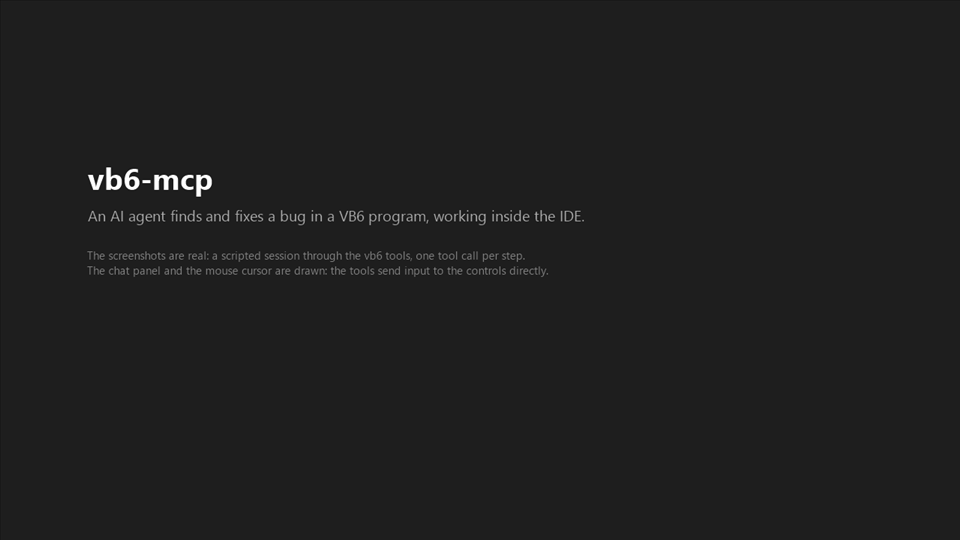

# vb6-mcp

An MCP server that lets AI agents (Claude Code) work **inside the Visual Basic 6 IDE** the way a developer does: read and edit live (unsaved) code, run and debug, drive the running app's UI, take screenshots, and build.

- **Design and decisions:** [PLAN.md](PLAN.md)
- **Rules for agents working on this repo:** [AGENTS.md](AGENTS.md)
- **Architecture:** [docs/architecture.md](docs/architecture.md)
- **Wire protocol (server ↔ add-in ↔ watchdog):** [docs/protocol.md](docs/protocol.md)
- **MCP tool reference:** [docs/tools.md](docs/tools.md)
- **Experiments that back the design:** [docs/spikes/](docs/spikes/)
- **What changed in each release:** [CHANGELOG.md](CHANGELOG.md)

- **What's next:** [docs/roadmap.md](docs/roadmap.md)

> Status: **version 1.0.0.** All planned phases are built: live code, debugging, UI automation, the watchdog, builds and sync, forms, references and COM, packaging, and the improvements from real use and benchmarks. The spike code under `spikes/` is throwaway and is never referenced by `src/`.

## What it does



*A scripted session on the Cart test fixture: an agent reproduces a wrong total, finds the cause at a breakpoint, fixes one line and checks the result. The screenshots are real; the chat panel and the cursor are drawn (the tools send input to the controls directly). Full quality: [the MP4](https://github.com/mika76/vb6-mcp/releases/download/v1.0.0/vb6mcp-demo.mp4) (81 s). Regenerate both with `node scripts/demo/video.js`, then `dotnet run --project scripts/demo/videomaker -c Release -- build/demo/video build/demo/demo.mp4 docs/media/demo.gif`.*

The agent works on what the developer sees in the IDE, not just on the files:

- **Code:** read and edit the code as the IDE holds it, unsaved edits included; symbols and every use of a name across projects; save explicitly.
- **Run and debug:** start, break, step, breakpoints, the current line, locals, call stack, Immediate window, run-time errors, compile errors from memory.
- **The running program:** list its forms and controls, click, type, select, press keys, wait for windows, take screenshots (also of a compiled EXE).
- **Forms:** read and set designer properties, add controls, lay them out in rows and columns, screenshot the designer.
- **Builds and COM:** build in the IDE or from disk, what to rebuild after a change, references, registration, binary compatibility, why a component won't load.
- **Safety:** unsaved work is never thrown away without being asked; edits are refused when the code changed since it was read; the elevated add-in accepts only a fixed list of commands; a hook stops the agent from going around the tools.

A typical session: `ide_list` (which IDEs and projects are open), `symbol_refs` (where a procedure is used), `proc_get` and `proc_replace` (change it), `syntax_check` (does it compile, as it is in memory), `run_start`, `app_click` and `app_screenshot` (try it in the running program), `run_end`, `project_save`.

## Limits

- **Windows 10/11 only.** The server is .NET 10, which doesn't run on Windows 7. Running Claude on another machine is planned for v2 ([docs/roadmap.md](docs/roadmap.md)).
- **Best in Claude Code; other agents work with less protection.** The server speaks plain MCP over stdio. GitHub Copilot CLI and OpenCode have been tested ([spike 40](docs/spikes/40-other-harnesses.md)): all 94 tools load, and `debug_eval`'s approval for side effects works there through MCP elicitation.
  - **Only in Claude Code:** the hook that stops an agent from editing VB6 files with its own edit tools (which can break their encoding and hidden lines) and asks before risky shell commands. Copilot edited a `.frm` with its built-in edit tool.
  - **The server instructions** don't reach the model in those clients by default. A line in your project's `AGENTS.md` telling the agent to use the vb6 tools for VB6 files helps.
  - **Screenshots** reach the model in Copilot CLI, but not in OpenCode.
  - **`server_restart`** only reconnects in Claude Code.
  - **The installer** registers the server with Claude Code only. Other clients need a config entry by hand: the command is `C:\Program Files (x86)\vb6mcp\vb6mcp.exe` with no arguments, and it reads the [workspace roots](#workspace-roots) from `roots.txt` next to it.
- **VB6 has no debugger API.** Debugging works through IDE commands and by reading the IDE's windows. Breakpoints the user sets by hand aren't known, and lightweight controls (Label, Image) only show in screenshots.
- **One machine.** The server, VB6 and the add-in run on the same Windows machine.

## Requirements

- Windows 10/11, **Visual Basic 6.0 (SP6)**, normally run **as Administrator**
- .NET 10 SDK (development only; the package needs no .NET)
- Claude Code (desktop app or CLI)

## License

MIT, see [LICENSE](LICENSE).

## Repository layout

| Path | What |
|------|------|
| `src/Vb6Mcp.Core` | Wire protocol, discovery, add-in client, VB6 file formats |
| `src/Vb6Mcp.UI` | Window enumeration, IDE title/mode, dialogs, screenshots, input for compiled programs |
| `src/Vb6Mcp` | `vb6mcp.exe`: the MCP server (stdio), the watchdog (`watchdog` mode), the hook and `describe` |
| `addin/VB6McpBridge` | The VB6 add-in that runs inside the IDE |
| `tests/Vb6Mcp.Tests` | Tests and our own minimal test runner |
| `tests/fixtures` | Small VB6 projects used by tests |
| `spikes/` | Phase 0 experiments (throwaway) |
| `docs/` | Architecture, protocol, tools, spike write-ups |
| `installer/` | `install.ps1`, `uninstall.ps1`, `INSTALL.txt`: shipped in the package |
| `scripts/` | development: `build-addin.ps1`, `install-server.ps1`; `package.ps1` builds `dist\vb6mcp-<version>.zip`; `demo/` records and renders the README demo |

## Build and test

```powershell
dotnet build vb6-mcp.slnx
dotnet run --project tests/Vb6Mcp.Tests                # unit tests (no VB6 needed)
dotnet run --project tests/Vb6Mcp.Tests -- --cat IDE   # needs a running IDE with the add-in
dotnet run --project tests/Vb6Mcp.Tests -- --all       # everything
```

The test runner's exit code is the number of failed tests.

## Install (users)

Download `vb6mcp-<version>.zip` from the [releases](https://github.com/mika76/vb6-mcp/releases) (or build it with `scripts\package.ps1`), unpack it anywhere, and run **as yourself** (not as administrator):

```powershell
powershell -NoProfile -ExecutionPolicy Bypass -File install.ps1 -Roots "D:\src;E:\work"
```

`-Roots` names the folders with your VB6 projects; see [Workspace roots](#workspace-roots) below.

**What you need:** VB6 (SP6) and Claude Code. No .NET is needed: `vb6mcp.exe` carries its own runtime (spike 26).

**What happens:**
- **One UAC prompt.** The add-in DLL, `vb6mcp.exe` (MCP server and watchdog) and `roots.txt` go to `C:\Program Files (x86)\vb6mcp`, and the DLL is registered.
  - Only administrators can change files there. That matters, because the add-in and watchdog run with VB6's administrator rights, and the roots decide what they may build, register and load (docs/architecture.md, "Security").
- **Your part, without elevation:**
  - VB6's add-in entry (HKCU);
  - `claude mcp add --scope user vb6`;
  - the Claude Code hook;
  - Claude Code's idle timeout for tool calls, set to 2 minutes (`CLAUDE_CODE_MCP_TOOL_IDLE_TIMEOUT` in `~/.claude/settings.json`; default 30 minutes), unless you set it already. A dead or frozen server then shows as an error within 2 minutes; slow vb6 calls send a heartbeat and keep running. It applies to all MCP servers; `-NoIdleTimeout` skips it.
- **Then restart VB6 and Claude Code.**

**Changing things later:**
- **Upgrade:** run the new package's `install.ps1`. Without `-Roots` it keeps the existing roots, and files in use are replaced too.
- **Change the roots:** run `install.ps1 -Roots ...` again.
- **Uninstall:** close VB6, then `powershell -NoProfile -ExecutionPolicy Bypass -File "C:\Program Files (x86)\vb6mcp\uninstall.ps1"`. `-RemoveData` also deletes `%LOCALAPPDATA%\vb6mcp`.

### Workspace roots

`-Roots` lists the folders vb6-mcp may work in, separated by `;`. Give the folders that hold your `.vbp` files, plus any shared source folders they include (a `.vbp` can pull in files from `..\Shared`).

- **Paths:** a file path a tool takes must be under a root: opening or building a project, reading or editing a file on disk, registering a component, extracting a picture. Anything else is refused. The exception is `com_describe`, which also reads a registered component's file wherever it is installed.
- **Searches:** workspace-wide searches (`ws_projects`, `symbol_refs`, `ws_affected`) look only under the roots.
- **Why:** the add-in and the watchdog run with VB6's administrator rights, so the roots also decide what they may build, register and load.
- **Where they live:** the installer writes them to `roots.txt` next to `vb6mcp.exe`, where only administrators can change them. To change them, run the installer again with new `-Roots`.
- **Keep them narrow:** a whole drive works, but every workspace search then scans all of it.

## Development setup

The steps below build from source and register the repo's builds instead of the Program Files install. A development add-in has no `roots.txt` next to its DLL, so it reads `%LOCALAPPDATA%\vb6mcp\roots.txt` (written by `install-server.ps1`). Its DLL and watchdog live in the user-writable repo, which is fine for development but not for users. Running `build-addin.ps1` re-registers the add-in from the repo; running `install.ps1` points it back at Program Files.

### 1. Build and register the VB6 add-in (elevated)

From an **Administrator** PowerShell (building an ActiveX DLL registers it machine-wide, and starting VB6 from a non-elevated shell triggers a UAC prompt):

```powershell
.\scripts\build-addin.ps1
```

- Unload the add-in in VB6 first (Add-Ins → Add-In Manager), or close VB6: a loaded DLL can't be overwritten.
- The first build ever creates the binary-compatibility reference `addin\compat\VB6McpBridge.dll` (committed), so the add-in's ProgID/CLSIDs stay stable.
- The script then registers the add-in with VB6 (`scripts\register-addin.ps1`, HKCU). It must run after the build: a VB6 that starts while the Addins key names an unregistered ProgID deletes the key.
- It also publishes the **watchdog** (`vb6mcp.exe`) into `addin\VB6McpBridge\build\watchdog`. The add-in starts it when it loads, and it inherits elevation with no UAC prompt. It handles a stuck IDE (Ctrl+Break, dialogs, kill, screenshots) and exits 2 minutes after the last VB6 closes (30 minutes after a crash, so a relaunch through it needs no UAC prompt). A running watchdog is stopped first, because it locks its exe. Its log is `%LOCALAPPDATA%\vb6mcp\watchdog.log`.
- **Let sessions start their own IDEs:** start the watchdog yourself with `--stay`, once, from an elevated PowerShell:
  - development: `scripts\build-addin.ps1 -WatchdogOnly -Stay`;
  - installed: `& "${env:ProgramFiles(x86)}\vb6mcp\vb6mcp.exe" watchdog --stay`.

  It then keeps running with no VB6 open, and `ide_launch` starts elevated IDEs through it without a UAC prompt each time. Only one watchdog runs per user session: start it when none is running.

**Restart VB6** (as Administrator): VB6 reads its add-in list only at startup. You should see a **"VB6 MCP" toolbar** showing `VB6 MCP <version> · built <time> · :<port> · <n> req`.

### 2. Install the MCP server for Claude Code

```powershell
.\scripts\install-server.ps1 -Roots 'D:\src\VB6Apps','D:\src\Shared'
```

`-Roots` sets the **workspace roots** (`VB6MCP_ROOTS`) for the disk tools (`ws_projects`, `ws_file_projects`, `file_read`): the folders that contain your `.vbp` files and any shared source folders. Paths outside them are refused. They are also written to `%LOCALAPPDATA%\vb6mcp\roots.txt` for the add-in. Run it again later without `-Roots` to reinstall with the roots already in that file.

Publishes `vb6mcp.exe` to `build\server\current\` and registers it at **local scope** for this folder (`claude mcp add --scope local vb6 …`). The path stays the same on every install: files a running server holds are renamed aside (`*.old-<stamp>`, removed by a later install). To switch a running session to the new build, ask the agent to call `server_restart`; the next vb6 call starts the new build. A new session also picks it up. Check the registration with `claude mcp get vb6` (run from this folder). The server's log goes to `build\vb6mcp.log`.

It also registers a **Claude Code hook** in `~/.claude/settings.json` (a backup is kept as `settings.json.vb6mcp-backup`). The hook stops agents editing VB6 source files with the generic Edit/Write tools, so they use the vb6 tools, which keep the 1252 encoding and hidden header lines and respect a running IDE. Pass `-NoHook` to skip it.

**Security defaults.** `debug_eval` only reads values: expressions with side effects (database writes, `Shell` and other process starts, file, registry and network access, scripts, `SendKeys`) are refused, because the IDE runs them with its (administrator) rights. If the agent really needs one, it calls again with `allow_side_effect: true`, and **your MCP client asks you to approve it**: in Claude Code the vb6-mcp hook shows a permission prompt; other clients (Copilot CLI, OpenCode, Codex) get a form through MCP elicitation, which the agent can't see or answer. A client with neither is refused, and so is Claude Code without the hook. A non-interactive run (`copilot -p`, `claude -p`) has nobody to ask, so the expression doesn't run. The hook's other checks (shell commands, Edit/Write on VB6 files) exist only in Claude Code. `-EvalOpen` (both `install.ps1` and `install-server.ps1`) registers the server with `VB6MCP_EVAL=open` to allow them without asking, flagged and audited. **What this protects against:** an agent working through the vb6 tools, not code running as you. Any program of yours can reach the elevated add-in directly. And code an agent writes into the project runs with the IDE's administrator rights as soon as it starts the program. That comes with running VB6 as administrator. [docs/tools.md](docs/tools.md) (`debug_eval`) has the details.

The hook also checks the agent's own **Bash and PowerShell commands** and **asks you** before running: database writes through `sqlcmd`, `osql`, `bcp in`, `Invoke-Sqlcmd`, ADO/ODBC scripts and the like (reads are allowed); writes to VB6 source files; `regsvr32`, `RegAsm` and registry edits (they go through the audited `com_register`); and ending or building with VB6 directly. In benchmark runs agents changed a test database with `sqlcmd`, using a login they found in the project's files. In headless runs (`claude -p`) nobody can approve, so these commands don't run (spike 33). Set `VB6MCP_SHELL_GUARD=off` in Claude Code's settings `env` to turn the shell checks off.

### 3. Use it

Open a project in VB6 (or let the agent call `project_open`, or `project_new` for a new one), then ask Claude to use the `vb6` tools: `ide_list` first, then whatever the task needs: code, debugging, the running app, builds, forms, references, COM (95 tools). See [docs/tools.md](docs/tools.md).

To see what's inside a DLL, OCX or type library (classes, methods, enums in VB syntax), without registering it:

```powershell
vb6mcp describe C:\path\to\Component.dll [TypeNameFilter]
```

## Elevated or not?

Whether VB6 runs as administrator is your machine's configuration (a "Run as administrator" shortcut or compatibility setting); a default install runs it non-elevated (spike 16). vb6-mcp works either way, tested both ways (spike 41: the integration tests and the demo scenario pass against a non-elevated VB6 without XP compatibility mode). `ide_list` shows `elevated` per IDE:

| | VB6 elevated | VB6 not elevated |
|---|---|---|
| Read/edit live code, open/save projects, dialogs | ✓ | ✓ |
| Build ActiveX DLL/OCX (registers the component) | ✓ | the file is written but not registered: registering needs admin rights. `build_make` says so (`registered: false`) and how to register it |
| Register a component (`com_register`) | ✓ | ✗ needs admin rights; the result says so |
| Input into the IDE / running app (`app_click`, `app_set_text`) | through the add-in only | through the add-in (Claude's computer use also works) |
| Screenshots (`app_screenshot`) | captured by the add-in | captured by the server |
| Starting VB6 from Claude (`ide_launch`) | UAC prompt (none while an elevated watchdog runs) | no prompt |
| Another add-in's error before ours loads | answered through the watchdog | answered by the server itself |
| Code the agent runs (Immediate, the project started from the IDE) | runs as administrator | runs with your rights |

Running VB6 without elevation is the safer choice when you don't need to register components.

`ide_launch` takes `elevation: auto | elevated | normal`. Machine-specific values come from configuration: `VB6MCP_VB6_EXE` (VB6.EXE; otherwise found via the registry) and `VB6MCP_ROOTS` (workspace roots).

## VB6 files

What agents meet in a VB6 folder, and what may touch it. The server instructions carry a short version.

| File | What it is | Who changes it |
|---|---|---|
| `.vbp` / `.vbg` | project / project group: members, references, controls, settings | the vb6 tools (`project_*`, `refs_*`), VB on save |
| `.bas` `.cls` `.frm` `.ctl` `.pag` `.dsr` `.dob` | source: modules, classes, forms, UserControls, property pages, designers, documents (Windows-1252, CR LF, hidden header and `Attribute` lines) | the vb6 edit tools only (the hook refuses Edit/Write) |
| `.frx` `.ctx` `.pgx` `.dsx` `.dox` | binary companions of the above: pictures, icons, list items, long text | VB alone, on save; change them through `form_set_property` (`@picture:`, `List`). The hook refuses Edit/Write |
| `.res` | resource file (strings, bitmaps) | VB's resource editor; the hook refuses Edit/Write |
| `.vbw` | VB's window layout for the project (which code and designer windows were open) | VB; harmless to lose, but not to edit |
| `<form>.log` | written next to a form when a control couldn't load (missing or unlicensed OCX) | VB; read it (`build_make` and `project_open` include it) |
| `.exp` `.lib` | export and import libraries VB writes when building an ActiveX DLL | VB's linker; by-products |
| `.oca` | VB's cached type information for an OCX, next to the OCX | VB; can be deleted, VB recreates it |
| `.scc` / `MSSCCPRJ.SCC` | source-control (SourceSafe) bindings | the source-control add-in |
| `.dep` | dependency list from the Package and Deployment Wizard | the wizard |

## Logs

All in `%LOCALAPPDATA%\vb6mcp\` unless noted:

| Log | Written by | What's in it |
|---|---|---|
| `server.log` (installed) / `build\vb6mcp.log` in the repo (development) | the MCP server (`VB6MCP_LOG`, set by `install.ps1` / `install-server.ps1`) | every request and answer (answers cut at 500 characters), start-up line with version and roots |
| `addin.log` | the add-in inside VB6 | verbs, deferred operations, errors from VBIDE |
| `watchdog.log` | the watchdog | health checks, dialogs answered, Ctrl+Break, kills, its own exe path |
| `audit.log` | server and add-in | input sent to windows, `debug_eval` (and database writes it spotted), launches, registrations, builds, rollbacks |
| `<form>.log` next to a form | VB6 | why a control couldn't load (missing or unlicensed OCX) |

Without `VB6MCP_LOG` the server logs to stderr, which only Claude Code's MCP logs show.

## Troubleshooting

| Symptom | Check |
|---------|-------|
| No "VB6 MCP" toolbar | Add-In Manager: is "VB6 MCP Bridge" loaded? `LoadBehavior` gets rewritten by Add-In Manager. Log: `%LOCALAPPDATA%\vb6mcp\addin.log` |
| "VB6 MCP Bridge" missing from Add-In Manager | Restart VB6 (list read at startup); re-run `scripts\register-addin.ps1` |
| Tools say "no VB6 IDE with the vb6-mcp add-in is running" | Discovery files in `%LOCALAPPDATA%\vb6mcp\instances\`; is the add-in loaded? |
| Tools say the IDE is busy | The debugged program is running a loop, or a dialog is open: `ide_status` |
| A vb6 call seems stuck, or fails with "sent no response or progress" | The server process ended or froze (slow calls send a heartbeat every 10 s, so silence means trouble). Check that a `vb6mcp.exe` is running and the end of its log (`server.log`; each line starts with its pid), then reconnect the vb6 server or restart the session. After `server_restart`, wait for its answer before the next call (spike 42) |
| Build fails with "Permission denied" | The add-in DLL is loaded in VB6: unload it first |
| `vb6` isn't in the app's Connectors list | Expected: Connectors shows claude.ai account connectors and desktop extensions. Claude Code's own MCP servers (like `vb6`) are listed under `/mcp` in the session |
| New tools don't show up after `install-server.ps1` | Ask the agent to call `server_restart`: the app starts the server again on the next vb6 call, from `build\server\current\` (the `/mcp` dialog has no Reconnect button for it). A session started before `install-server.ps1` used the fixed folder needs one restart first (PLAN.md E7) |
| Installed: tools refuse a path you expect to work | It must be under the roots in `C:\Program Files (x86)\vb6mcp\roots.txt`; change them with `install.ps1 -Roots ...` (one UAC prompt) |
| Install says "the elevated part didn't start (UAC declined?)" | The UAC prompt was declined or never seen (it can open behind other windows); run it again |
| Build fails: "Errors during load … could not be loaded" | Read the `<form>.log` next to the form. "license not found" means a licensed control (e.g. Desaware SpyWorks) whose developer licence isn't installed on this machine: install the product, not just the OCX (spike 27) |
| Build fails: "Can't find project or library" or "User-defined type not defined" on a reference's type | `refs_fix_broken` / `com_diagnose`. A .NET COM DLL registered without a type library needs `RegAsm <dll> /tlb` (elevated), then reload the project (spike 27) |
| `ide_launch` with `normal` says elevation is required | VB6.EXE has a "Run as administrator"/compatibility setting on that path (spike 16); use `auto`/`elevated` or change the setting |
| Opening or creating a project shows "Add this project to SourceSafe?" | Your source-control add-in; `project_open` and `project_new` report it and leave the answer to you (No still leaves a read-only `MSSCCPRJ.SCC` in the folder) |
